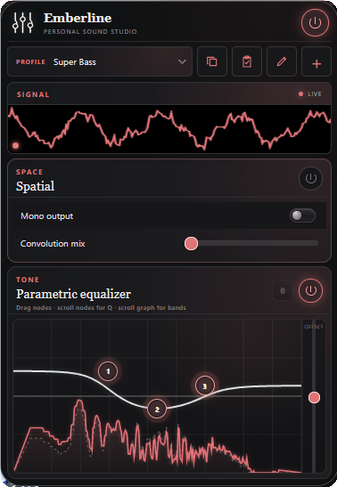

# Emberline

A browser extension for shaping media playback with a parametric equalizer, spatial controls, named presets, and live audio visualizers. Emberline uses Manifest V3 and currently targets Firefox and Chromium-based browsers.

Install the published release from [Firefox Add-ons](https://addons.mozilla.org/en-US/firefox/addon/l33s-audio-equalizer/).



## Features

- **Parametric equalizer**: Shape 2–16 freely positioned bands on a logarithmic frequency graph, with low- and high-shelf endpoints.
- **Direct graph controls**: Drag nodes for frequency and gain, scroll a node for Q, and scroll the graph to change the band count.
- **Live analysis**: Compare source and processed spectra alongside a time-domain signal display.
- **Visualizer hibernation**: Suspend analyzer streaming with the small LED control; streams also stop automatically when the popup closes.
- **Spatial controls**: Blend a built-in convolution impulse response and switch the output to mono.
- **Master EQ offset**: Move the complete response vertically or bake the offset into the filter curve.
- **Named presets**: Save, rename, delete, copy, and import complete configurations.
- **Per-site power**: Prevent Emberline from initializing on incompatible or DRM-protected sites; Spotify is disabled by default.
- **Efficient lifecycle**: Audio processing and convolution assets initialize only when they are needed.

## Installation

1. Clone or download this repository.
2. Install dependencies and build the extension:

   ```sh
   npm install
   npm run build
   ```

   To launch the development build, create a Firefox profile named `Testing`, then run:

   ```sh
   npm run start
   ```

3. Load the appropriate directory as an unpacked extension:

   - **Firefox**: Use [web-ext](https://github.com/mozilla/web-ext) or load as a temporary add-on.
   - **Chrome/Opera/Chromium**: Run `npm run build:chromium`, open the browser's extensions page, enable Developer Mode, and load `dist/chromium/`.

## Chromium packaging

Firefox remains the source build in `extension/`. Chromium packages are staged
separately in `dist/chromium/`; the build removes Firefox-only manifest metadata
and copies only files used at runtime.

Run `npm run package:opera` or `npm run package:chrome` to create
`web-ext-artifacts/emberline-chromium.zip`. The same package can be uploaded to
Opera Add-ons or the Chrome Web Store. These commands do not modify the Firefox
manifest or submit anything to Mozilla.

- **Opera:** Upload the ZIP through the [Opera Add-ons developer portal](https://addons.opera.com/developer/).
- **Chrome:** Upload the ZIP through the [Chrome Web Store developer dashboard](https://chrome.google.com/webstore/devconsole/).

## Signing

Copy `.env.example` to `.env`, set `WEB_EXT_API_KEY` and `WEB_EXT_API_SECRET`
to your Mozilla Add-ons API credentials, then run `npm run sign`. This submits a
listed release to Mozilla Add-ons. The npm scripts load `.env` with Node.js, so
use Node.js 22.9 or newer. The `.env` file is ignored by Git; never commit
credentials to the repository.

Run `npm run sign:dry-run` to verify that both credential variables are present,
build the extension, and lint it locally. This does not contact AMO or validate
the credentials; `npm run sign` submits the extension for signing.

## Personalizing the mixer

Use the popup to shape the equalizer, adjust spatial controls, and manage named
presets. Presets include convolution, output mode, EQ master offset, gain, Q,
shelf behavior, band count, and exact frequencies. Changes apply immediately
and preferences are stored locally in the browser.

Some protected media sites do not permit Web Audio interception. Use the master
power button in the popup header to disable Emberline for the current hostname;
the tab reloads so the page can start again without an attached audio graph.
